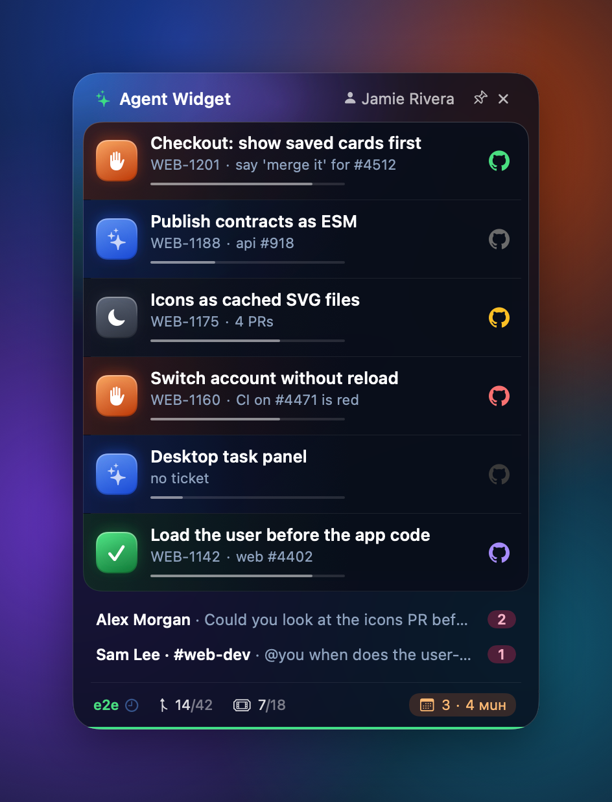
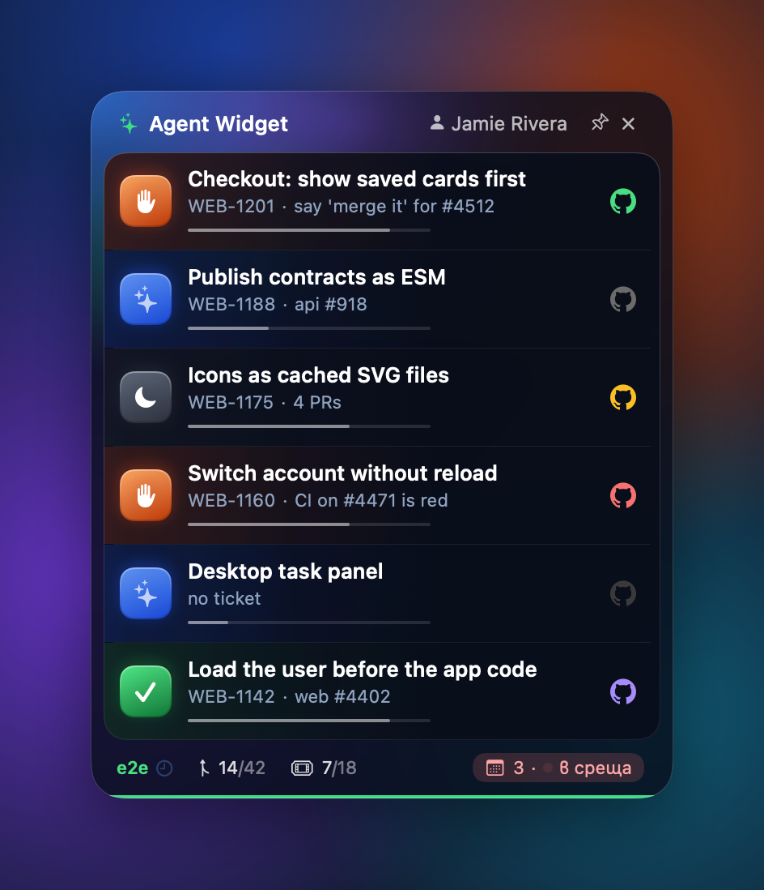
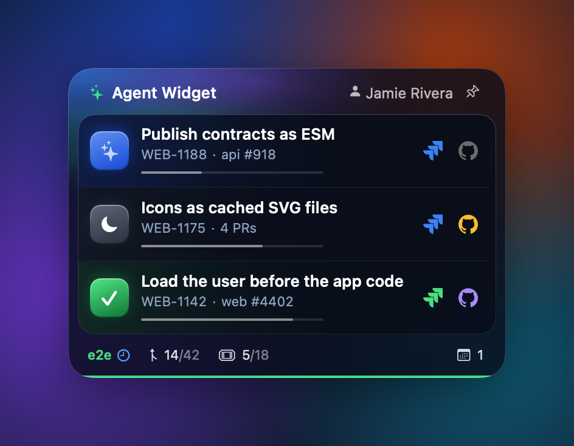

# BirdWatcher

**Everything your AI agents and your tickets are doing, on one glass panel on your Mac desktop.**

BirdWatcher sits on your wallpaper (or, pinned, above every window) and answers one question at a glance: *what needs me right now?* It joins your Claude Code sessions, your pull requests, your Jira tickets, your Slack, your e2e runs and your calendar into one short list, one row per task.

<p align="center">
  
</p>

| In a meeting | A quiet afternoon |
|---|---|
|  |  |

---

## What you see

### One row per task
Sessions, PRs and tickets that share a Jira key (`WEB-1201`) are one task. Each row shows:

- **Agent status**: the coloured square.
  - 🟧 **Orange waving hand**: an agent asked you a question and is waiting for your answer. These rows always come first.
  - 🟦 **Blue sparkles**, lighting up in turn: an AI agent is working right now.
  - 🟩 **Green check**: the agent finished.
  - ⬛ **Slate moon**: nobody is working on it, but something is still open (a PR, a ticket).
- **Title, Jira key and a one-line note**: what the agent is asking you, or which PR it is.
- **Stage bar**: how far the work has got.
  `code → pushed → AI review → CI build → on staging → on prod`
  Hover any point of the bar to see that stage and whether it is done, running or next.
- **GitHub icon**, coloured by the PR's status: grey draft, light blue waiting for AI review, yellow CI running, red CI failing or a conflict, green ready to merge, violet merged. Hover it to see what its colour means; click it to open the PR.

Click a row to jump straight into that Claude session.

### Slack
Unread direct messages and mentions appear under the tasks, one line each, and disappear once read. Click a line to open Slack.

### Footer
- **`e2e`**: green or red by the last run of the e2e workflow you configure (for example the full suite every release build goes through), with a blinking clock while one is running. Hover it for how many of the last 10 passed; click it to open the run.
- **PRs**: PRs you opened this week / this month.
- **Tickets**: your open Jira tickets / tickets done this month (hidden until Jira is set up).
- **Calendar**: today's meeting count. Ten minutes before a meeting it turns into an orange `3 · 4 мин` pill; during a meeting it turns into a red `3 · в среща` pill. Click it to join the call.
- **Week bar**: the panel's bottom edge fills in your accent colour from Monday 09:00 to Friday 18:00. Hover it for the day and the week's progress.

### Pin and the menu bar icon
The pin in the header moves the panel above every window, including full-screen apps. Click it again to send the panel back to the desktop.

The ✕ in the header closes the panel. The ticket in the menu bar shows its state, outlined while the panel is open and filled while it is closed; click it for a menu with **Open / Close panel**, a short summary (tasks, who's waiting for you, Slack, the next meeting, e2e), **Pin above all windows**, **Refresh now**, **Move to this screen** (when the panel was left on a display that's gone) and **Quit**.

---

## Use cases

**"Which of my agents is stuck on me?"**
You run five Claude Code sessions in parallel. Instead of clicking through each one, look for the orange hands at the top of the panel. Each one has the agent's question in its note line, e.g. `say 'merge it' for #4512`. One click opens that session.

**"What is left before this ships?"**
A task's stage bar shows where it stopped: the AI reviewer, CI, waiting for merge, or on staging and waiting for the prod release. A red GitHub icon means CI is failing or there is a conflict.

**"My agent stopped but the work isn't done."**
A task with an open PR stays on the panel with the moon icon after its session ends, so a PR waiting for CI never gets forgotten.

**"Am I about to be late?"**
The calendar pill turns orange ten minutes before a meeting and red once it has started. Click it to join.

**"Did someone ping me?"**
The Slack lines appear only while there are unread DMs or mentions, so an empty panel means nobody is waiting for you there.

**"How did the week go?"**
The footer counts this week's PRs and closed tickets against the month, and the green week bar shows how much of the working week is gone.

**"I need it in front of me while I code."**
Pin it. It floats above your editor; unpin it when you want your screen back.

---

## Install

Requirements: macOS 15 or later, the Xcode Command Line Tools (`xcode-select --install`), Homebrew Python 3 and the GitHub CLI signed in (`gh auth login`).

```bash
git clone git@github.com:aleksandrenko/agent-widget.git ~/agent-widget
mkdir -p ~/.agent-widget && cp ~/agent-widget/config.example.json ~/.agent-widget/config.json   # then edit it
~/agent-widget/build.sh
```

`build.sh` compiles the app with the Command Line Tools (no Xcode project and no Xcode licence needed), installs it to `/Applications/BirdWatcher.app` (or `~/Applications` if that isn't writable), puts an icon on your Desktop, starts it, and registers it to start at login. If you stop it from the menu, start it again from Spotlight, Apps or the Desktop icon; opening it while it runs shows the panel.

> The app runs the collector from `~/agent-widget/collector/collect.py`, so keep the clone at `~/agent-widget`.

### Configuration
Everything specific to your company lives outside the repo, in `~/.agent-widget/`:

| File | What |
|---|---|
| `config.json` | Copy of [`config.example.json`](config.example.json). `brand`: header name and accent colour. `jira`: your site, project keys, and which statuses count as active. `e2e`: the GitHub repo, workflow (file name or id) and run-title prefix to watch. `prodComment`: the text your release bot comments on a PR once it is in production. |
| `brand.svg` | Optional. Your logo mark for the header, drawn in the accent colour. Without it the header shows ✨. |

Leave a section empty and that part of the panel stays empty (no Jira icons, no `e2e`).

### First run
- **Calendar**: macOS asks once for calendar access. Your work Google account must be added in *System Settings → Internet Accounts* for meetings to show up.
- **Jira**: store an API token in the keychain:
  ```bash
  ~/agent-widget/setup-jira-token.sh
  ```
  Create the token at <https://id.atlassian.com/manage-profile/security/api-tokens>. Without it, the Jira icons stay grey and the ticket count shows `–`.
- **Slack**: nothing to set up. The count comes from the number on Slack's Dock icon.

---

## How it works

```
┌─────────────────────────────┐  every 60 s   ┌──────────────────────────────┐
│  BirdWatcher.app (SwiftUI)  │ ────────────▶ │ collector/collect.py         │
│  · glass panel on desktop   │               │  · Claude session files      │
│  · calendar via EventKit    │ ◀──────────── │  · gh: PRs, reviews, CI, e2e │
│  · hover tooltips, clicks   │ tasks.json    │  · Jira REST (keychain token)│
└─────────────────────────────┘               │  · Slack Dock badge          │
                                              └──────────────────────────────┘
```

- The **collector** reads the Claude desktop app's session files, asks GitHub for your open and recently merged PRs, asks Jira for your tickets, groups everything by Jira key and writes `~/.agent-widget/tasks.json`.
- The **app** runs the collector every minute and redraws the panel. It reads meetings straight from the Mac's calendars.

Full rules, covering how sessions are linked to tickets, which tasks are shown and how stages are worked out, are in [docs/how-it-works.md](docs/how-it-works.md). The visual spec is in [docs/design.md](docs/design.md).

---

## Development

```bash
python3 -m unittest collector/test_collect.py   # collector test cases
./build.sh                                      # build, install, restart
./tools/screenshots.sh                          # re-render docs/screenshots from docs/demo
open -g "agentwidget://refresh"                 # collect now
open -g "agentwidget://snapshot"                # write the live panel to ~/.agent-widget/panel.png
```

**Demo mode**: `/Applications/BirdWatcher.app/Contents/MacOS/BirdWatcher --demo docs/demo/default` shows sample data and touches nothing else: no collector, no login item, no saved position. Add `--snapshot out.png` to write a picture of the panel and quit. The README screenshots are made this way, so they never show real work.

### Layout
```
App/                 SwiftUI app: panel, tooltips, calendar, demo mode
  Resources/         Jira and GitHub marks (SVG)
collector/           collect.py and its test cases
docs/                design spec, how it works, demo data, screenshots
tools/               screenshot compositor, app icon (icon.swift → App/AppIcon.icns)
build.sh             build, install, start
config.example.json  settings template for ~/.agent-widget/config.json
setup-jira-token.sh  Jira token to the keychain
```

## Troubleshooting

| Symptom | Fix |
|---|---|
| No panel after `build.sh` | It may be on another display. Run `defaults delete com.nikolay.agentwidget panelTopLeft`, then `./build.sh`. |
| Jira icons grey, ticket count `–` | Set `jira.site` in `config.json`, then run `./setup-jira-token.sh` (the token may have expired). |
| Calendar shows `–` | Calendar access was denied: *System Settings → Privacy & Security → Calendars → BirdWatcher*. |
| Calendar shows `0` | Add your work Google account in *Internet Accounts*. |
| Nothing updates | Check `~/.agent-widget/collect.log`, or run `python3 collector/collect.py` by hand. |
| A session sits under the wrong task | The Jira key comes from the session title, folder, branch, or the keys you typed in it. Mention the right key once in the session. |

## Roadmap
- Slack names and message previews (needs a personal Slack token; today it shows the unread count).
- Prod detection beyond the release-comment check for services outside the standard pipeline.
- Settings for working hours, how many tasks to show, and the meeting warning time.
